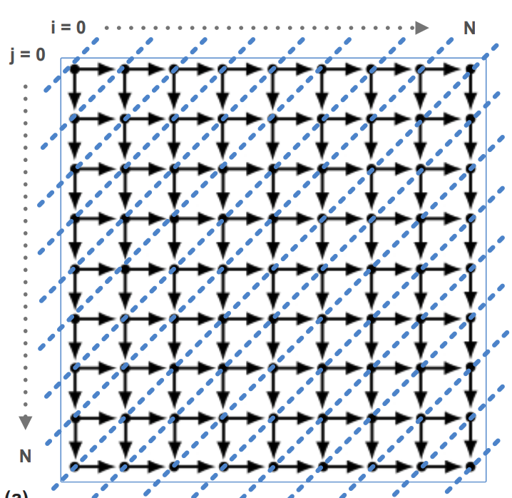

> [!WARNING]
> Some code snippets shown in the blog are AI generated. They are only used to demonstrate concepts. The author takes complete responsibility of any and all semantic and conceptual meaning conveyed by these snippets

> [!IMPORTANT]
> Core content in the blog is not AI generated. All texts and explainations have been given by the author himself

# Blog structure
- Need to decide on a story for this approach

## Idea 1: Start with architecture story
- Out of Order processors
    - well proven and established for general web-based workloads
- VLIW: Failed for generic workloads; Bet was that compilers will extract scheduling out of workloads
    - scheduling instructions onto the processor becomes purely compiler's responsibility
    - claim: compiler engineers can extract performance from kernels
    - auto-parallelisation techniques mostly failed for workloads with complex control-flow and dataflow structure
    - tbd in compilers sections
 - AI workloads: highly deterministic in nature
    - embarrisingly parallel
- VLIW suddenly becomes important since compile-time performance extraction becomes important

## Idea 2: Compilers POV
- Conventional compiler structure
    - Language design: frontend
    - IR: Each language eventually lowered to its own IR for applying optimizations
    - LLVM-IR/GCC: Lowered to backend specific codes
- Conventional compilers challenges
    - Loop-level representations lost at LLVM level
    - IR for language specs were limited; Same infrastructure was being re-implemented for every langugage in the market (AST, local block level optimizations, etc)
- Workloads Specific challenges
    - Compile-time techniques historically failed due to lack of compile-time information
    - Polyhedral Analysis
        - polyhedral analysis: hits the bounds of canonical loop form, with perfect loop nest and perfect polyhedron criterias (affine loop bounds - explain this); work done for generalising, but not successful for CPU workloads of the internet age - largely due to cross-iteration dependencies
        - explain this with code examples
        ```cpp
        // Can be parallelised
        void matrix_add(int N, int M, int A[N][M], int B[N][M], int C[N][M]) {
            // Both loops have predictable, affine bounds (0 to N, 0 to M).
            for (int i = 0; i < N; i++) {
                for (int j = 0; j < M; j++) {
                    // The access patterns (i, j) are perfectly affine functions 
                    // of the loop iterators.
                    C[i][j] = A[i][j] + B[i][j];
                }
            }
        }

        // Dependencies exist - but can be partially parallelised by polyhedral analysis
        void wavefront_parallelism(int N, int M, int A[N][M]) {
            for (int i = 1; i < N; i++) {
                for (int j = 1; j < M; j++) {
                    // Cross-iteration dependencies exist on both axes.
                    // (i, j) depends on the results of (i-1, j) and (i, j-1).
                    A[i][j] = A[i - 1][j] + A[i][j - 1];
                }
            }
        }
        ```


        ```cpp
        // Cannot be parallelised - a[b[i]] - breaks affine access pattern guarantees
        void indirect_access(int *A, int *B, int *index, int N) {
            for (int i = 0; i < N; i++) {
                // Polyhedral analysis fails here.
                // The access A[index[i]] is not an affine expression of 'i'.
                // The compiler cannot determine at compile-time if index[i] 
                // causes loop-carried dependencies (e.g., if index[0] == index[1]).
                A[index[i]] = B[i] + 1;
            }
        }
        // Talk about the pointer-chasing pattern
            - dynamic data: problem in general
            - vectorization becomes impossible
            - commonly found in graph and database applications

        // Cannot be parallelised - Parallelisation fails due to cross-iteration dependence
        void strict_recurrence(int N, int A[N], int B[N]) {
            for (int i = 1; i < N; i++) {
                // Read of A[i-1] depends directly on the write to A[i] 
                // from the immediately preceding iteration (i - 1).
                A[i] = A[i - 1] + B[i];
            }
        }
        ```
    - [](images/wavefront-parallelism.png)A visual of wavefront parallelism across the iteration space. Credit - PeerWave (ICS'15)
    - Compiler analyses had to deal with arbituary/unstructured control and data flow in programs
        - Analysis results suffer with precision issues
    - Alias analysis, Pointer analysis, etc became extremely complicated
- Advent of AI: Producer-Consumer workloads
    - Workloads have pre-defined structure; entire compute graph available at compile-time; made aggressive optimzations possible
    - Producer-consumer structure; reasoning fundamentally different from loop-level or object-oriented general purpose or HPC programs; Memory optimizations became possible
        - Describe this better - fundamentally how?
    - Control and dataflow structures were no longer complicated at a high-level
    - High level information, when propagated to tensor-level programs - aided optimizations which would not have been otherwise possible; mainly by providing guarantees inferred from high-level model compute graph structure
        - ex: loop fusion, tensor aliasing, tensor shapes, etc

```cpp
#include<iostream>
int main() {
    std::cout << "Hello sailor!" << std::endl;
}
```
